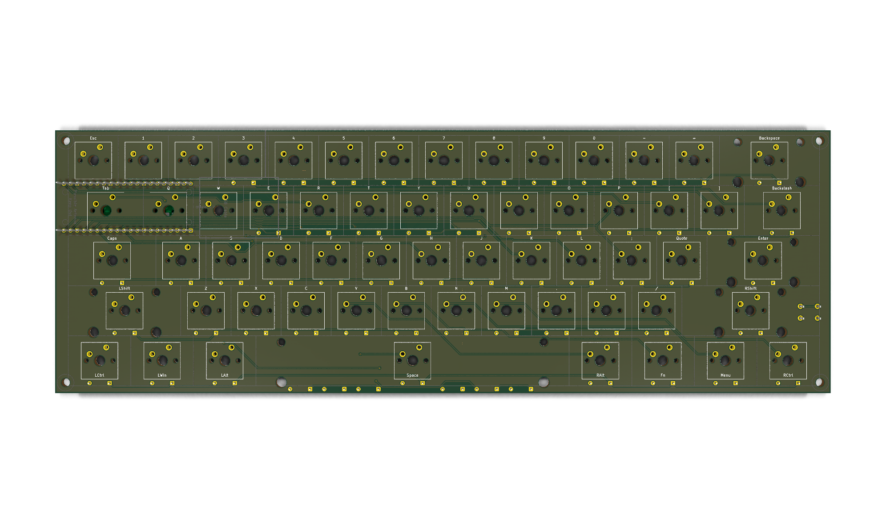
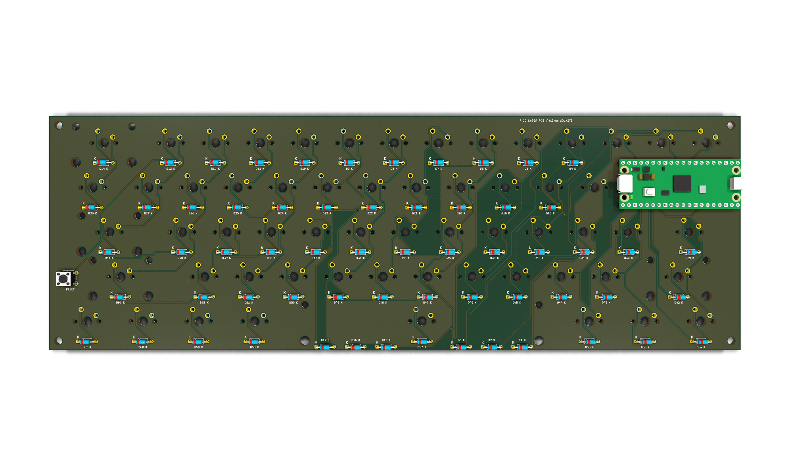

# Keyboard 
Hello, this is a Keyboard Project which was my first time developing a PCB, after numerous errors and attempts, I finally got it done thanks to the Half Life Program at Hack Club. 
Firmware for the Raspberry Pi Pico is in the firmware folder, while the PCB and schematic files are in the main folder. Inside of the keyboard61 folder you can find the fabrication files for the circuit board. The layout and pictures have also been put there.

## Bill of materials

This table lists the whole planned build and who is responsible for each purchase. The Hack Club request covers only the rows marked **Hack Club funding request**, the other parts are planned personal purchases. Prices are estimates in USD before checkout unless noted. The PCB estimate is from the older, larger outline and needs a new quote for the compact layout.

| Part | Qty | Unit | Total | Vendor | Buyer |
| --- | ---: | ---: | ---: | --- | --- |
| [Keyboard PCB, batch of 5](https://cart.jlcpcb.com/quote) | 1 | $31.15 | $31.15 | JLCPCB | Hack Club funding request; re-quote revised board |
| [onsemi 1N4148 DO-35 diodes](https://www.digikey.com/en/products/detail/onsemi/1N4148/458603) | 61 | $0.0422 | $2.57 | DigiKey | Hack Club funding request |
| [Raspberry Pi Pico H](https://www.digikey.com/en/products/detail/raspberry-pi/SC0917/16608257) | 1 | $5.00 | $5.00 | DigiKey | Hack Club funding request |
| [Adafruit Pico female socket pair](https://www.digikey.com/en/products/detail/adafruit-industries-llc/5583/16688063) | 1 pair | $0.95 | $0.95 | DigiKey | Hack Club funding request |
| [Adafruit 4111 USB-A to Micro-B cable, 1 m](https://www.digikey.com/en/products/detail/adafruit-industries-llc/4111/9992197) | 1 | $3.95 | $3.95 | DigiKey | Hack Club funding request |
| **Hack Club request parts subtotal** |  |  | **$43.62** |  |  |
| Tax and shipping estimate (not a current checkout quote) | 1 | $20.00 | $20.00 | Multiple vendors | Hack Club request estimate |
| **Estimated Hack Club total** |  |  | **$63.62 of $65** |  | **$1.38 remaining; confirm current carts** |
| [Gateron Milky Yellow Pro V2, 70 switches](https://www.amazon.com/dp/B0BBPPP7HD) | 1 pack | $19.99 | $19.99 | Amazon | Personal purchase |
| [XVX green keycap set](https://www.amazon.com/dp/B0DNMV32L2) | 1 set | $13.99 | $13.99 | Amazon | Personal purchase |
| [Chilkey snap-in stabilizer kit](https://www.amazon.com/dp/B0D2KMVVL3) | 1 kit | $21.99 | $21.99 | Amazon | Personal purchase |
| [Tactile reset buttons, 126-piece pack](https://www.amazon.com/dp/B0D5M2ZNSL) | 1 pack | $4.66 | $4.66 | Amazon | Personal purchase |
| [M3 nylon standoff and fastener kit](https://www.amazon.com/dp/B0G3XCGSNV) | 1 kit | $6.99 | $6.99 | Amazon | Personal purchase |
| [Adafruit rotary encoder with knob](https://www.adafruit.com/product/377) | 1 | $4.50 | $4.50 | Adafruit | Personal purchase |
| [Adafruit 1955 jumper wire pack](https://www.adafruit.com/product/1955) | 1 pack | $3.95 | $3.95 | Adafruit | Personal purchase |
| [ShillehTek AA317 2.8-inch ILI9341 TFT](https://shillehtek.com/products/2-8-spi-tft-lcd-touch-screen-module-240x320-ili9341-for-arduino) | 1 | $10.99 | $10.99 | ShillehTek | Personal purchase |
| Paid printing service for case, plate, and spacers | 1 | Quote needed | Quote needed | TBD | Personal purchase; quote current CAD |
| **Personal parts subtotal** |  |  | **$87.06** |  | **Before tax, shipping, and printing** |
| **Combined known parts subtotal** |  |  | **$130.68** |  | **Before tax, shipping, and printing** |

The $20 tax-and-shipping amount is a planning placeholder, not a confirmed cart total. The Amazon prices were last checked October 7, 2026 and need checkout verification. The prior enclosure-print quote used older geometry and is not included.

## Compact PCB layout

The current KiCad board outline is 295.05 × 100.05 mm, reduced from the earlier 295 × 168 mm layout. The Pico is mounted on the underside beneath the left key area, so it does not need a separate blank strip above the keyboard. Moving it beside the full-width key matrix would require a wider board or a separate wired module, so the current compact outline keeps it inside the keyboard footprint. The two KiCad 3D renders below show the front and underside, physical clearance still needs a hardware fit check.

Here are some images of my work!

